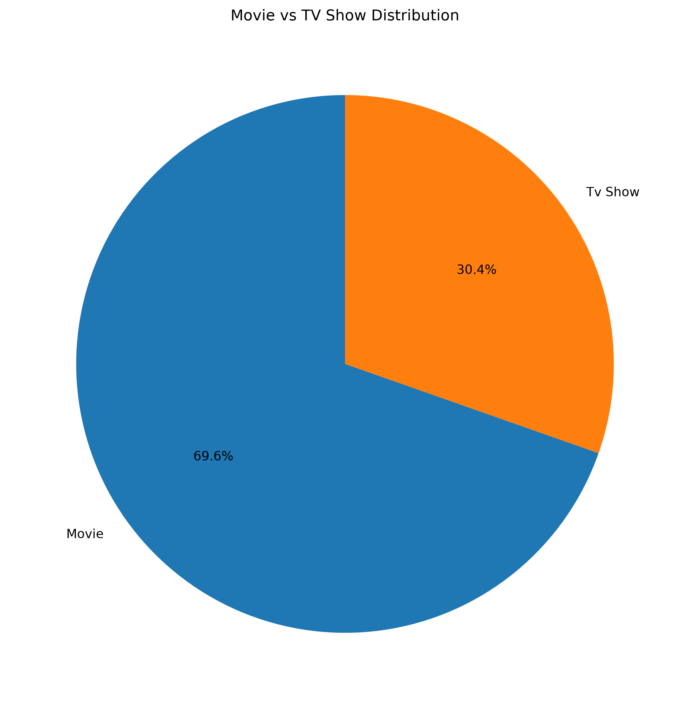
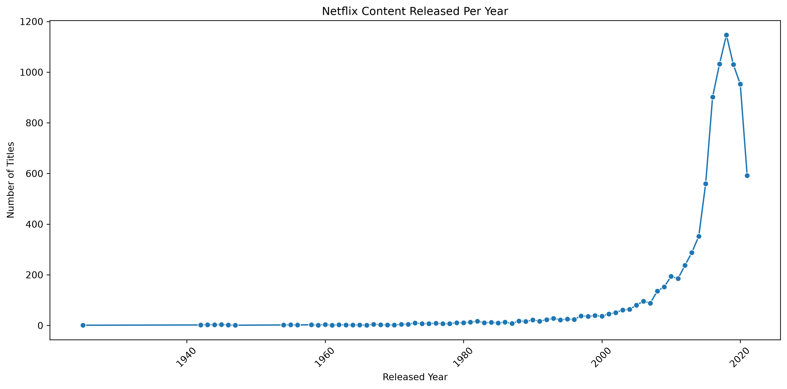
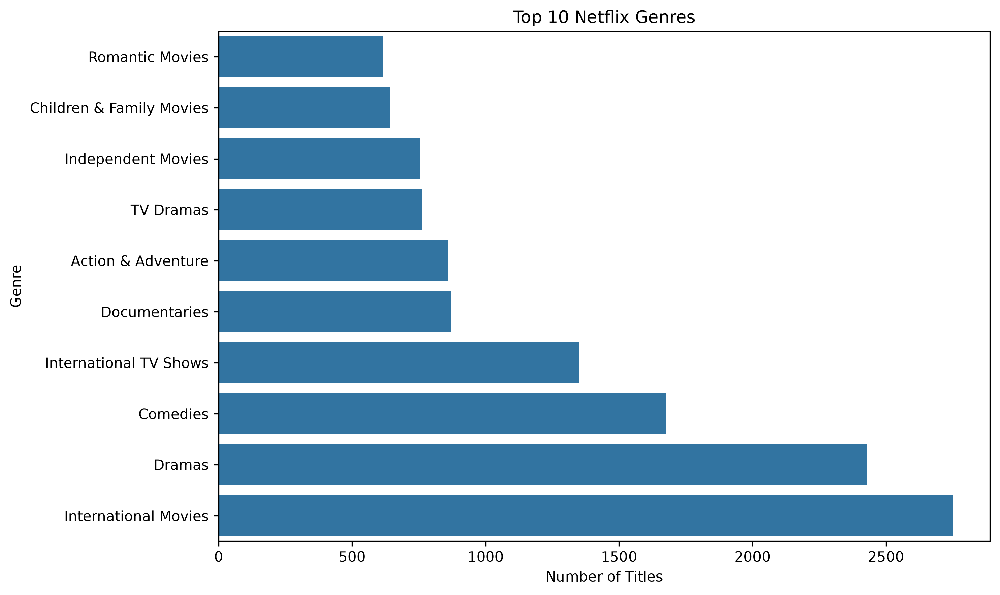
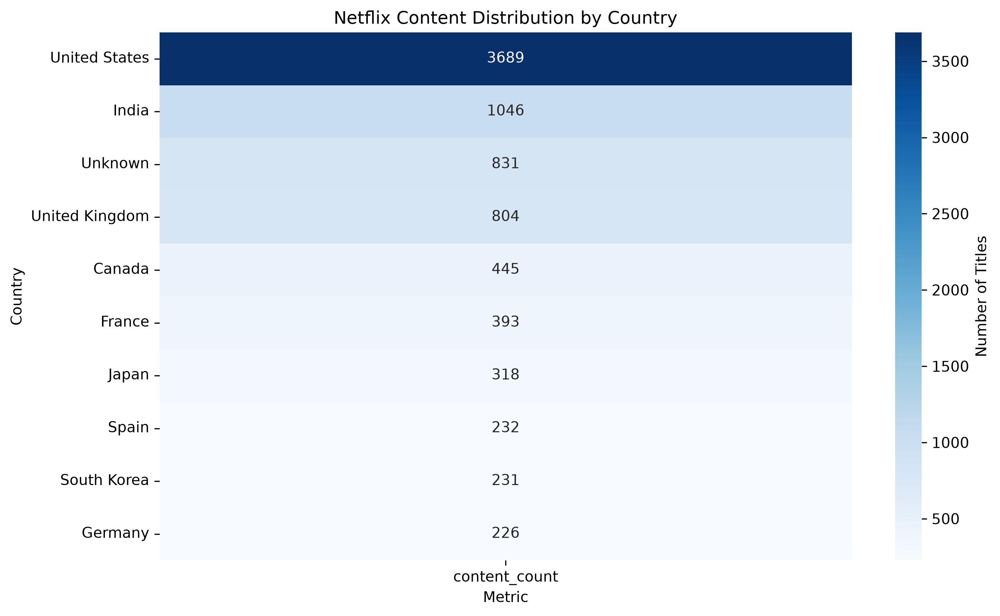
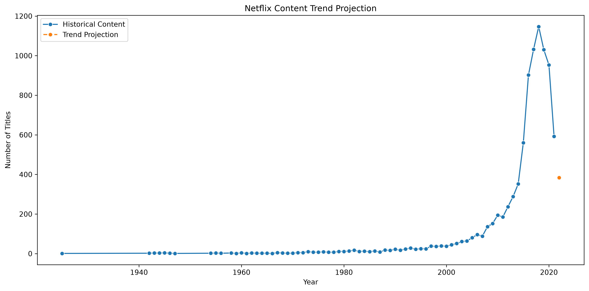

# Netflix Titles: Exploratory Data Analysis

**Report type:** Descriptive exploratory analysis   
**Dataset:** `data/raw/netflix_titles.csv` (8,807 title records)  
**Status:** Snapshot analysis; findings are descriptive, not causal or predictive

## Executive summary

This report examines the title metadata in the project dataset to describe its content mix, release-year distribution, genre labels, country representation, and recorded Netflix addition dates. The analysis finds that movies account for 69.6% of titles, 67.3% of titles have release years in the 2010s, and 2018 is the most represented release year. When multi-value fields are split into individual labels, International Movies is the most frequent category and the United States is the most frequent country. Among records with an addition date, 2019 has the highest count.

These results describe the supplied dataset only. Its latest recorded `date_added` is 25 September 2021, so it should not be interpreted as a current inventory of Netflix's catalog. The repository does not document the dataset's original publisher, download date, version, or license; those details should be established before external or commercial reuse.

## 1. Purpose and scope

The purpose is to provide a reproducible descriptive overview of the supplied Netflix titles metadata and identify patterns that could guide further analysis. The report addresses:

- How the recorded titles are divided between movies and TV shows.
- Which release years and decades have the most titles in this dataset.
- Which category and country labels occur most frequently.
- How recorded addition dates are distributed by year.

The analysis does not assess title popularity, audience demand, revenue, current availability, content quality, or causal drivers of catalog composition. It is not a recommendation or acquisition forecast.

## 2. Dataset and provenance

The source file contains **8,807 rows and 12 columns**: `show_id`, `type`, `title`, `director`, `cast`, `country`, `date_added`, `release_year`, `rating`, `duration`, `listed_in`, and `description`. Each `show_id` is unique, and no exact duplicate rows were found. Release years range from **1925 to 2021**.

The project uses the CSV at `data/raw/netflix_titles.csv` as its analysis input. The repository does not identify the upstream source or provide a dataset version, acquisition date, or license. Accordingly, this report does not claim independent provenance or licensing verification.

### Data quality

Missing-value counts below are from the raw CSV:

| Field | Missing records | Share of all records |
|---|---:|---:|
| `director` | 2,634 | 29.9% |
| `country` | 831 | 9.4% |
| `cast` | 825 | 9.4% |
| `date_added` | 10 | 0.1% |
| `rating` | 4 | <0.1% |
| `duration` | 3 | <0.1% |

There are 8,797 records with a parseable `date_added`, ranging from **1 January 2008 to 25 September 2021**. The 2021 addition count therefore covers only part of that calendar year.

## 3. Methodology

The analysis is implemented in Python modules under `src/` and follows this sequence:

1. **Inspect:** load the source CSV and review dimensions, data types, descriptive statistics, missing values, and duplicate rows.
2. **Clean:** remove exact duplicate rows; fill missing `director`, `cast`, `country`, `rating`, and `duration` values with `Unknown`; parse `date_added` as a date; and trim leading/trailing whitespace in text fields. Missing or unparseable dates remain missing.
3. **Engineer features:** derive `release_decade`, `is_movie`, standardized `content_type`, and `added_year`.
4. **Aggregate and visualize:** count titles by type and release year; split the comma-separated `listed_in` and `country` fields into individual labels for ranking; and generate the five charts in `outputs/`.

### Counting definitions

- **Content-type shares** use all 8,807 title records as the denominator.
- **Release-year counts** count records grouped by `release_year`; release year is not the same as the year a title was added to Netflix.
- **Category and country counts** count title-label associations after splitting the corresponding field on comma-space. A title with multiple labels or countries contributes to each applicable count, so these counts are not mutually exclusive.
- **Addition-year counts** group non-missing `date_added` values by calendar year. Their denominator is 8,797 dated records, not all 8,807 records.
- **Trend projection** fits a first-degree polynomial (straight line) to the dataset's annual release-year counts and extends it one year beyond the latest observed release year (2022). It is a simple illustration, not a validated forecast.

## 4. Results

| Finding | Result | Basis |
|---|---|---|
| Movies are the majority | 6,131 movies (69.6%); 2,676 TV shows (30.4%) | Share of all 8,807 titles |
| Release years concentrate in the 2010s | 5,927 titles (67.3%); 2018 is the leading release year with 1,147 titles | Release-year records |
| Most frequent category labels | International Movies: 2,752; Dramas: 2,427; Comedies: 1,674 | Split title-category associations |
| Most frequent country labels | United States: 3,689; India: 1,046; United Kingdom: 804 | Split title-country associations |
| Most recorded additions occurred in 2019 | 2019: 2,016 (22.9%); 2020: 1,879 (21.4%); 2021: 1,498 (17.0%) | Share of 8,797 records with a date |

The detailed five-point summary is available in [insight_summary.md](./insight_summary.md).

## 5. Visual analysis

### Content type



The chart makes the movie majority visible; it shows catalog composition, not viewing behavior or demand.

### Titles by release year



The counts peak in the late 2010s in this dataset. These are release years of included titles and should not be read as the number of all films or shows released globally in each year.

### Category labels



Counts are based on individual labels, so a title can contribute to more than one bar. Labels such as “International Movies” and “International TV Shows” are retained as supplied; this analysis does not recategorize them into a single taxonomy.

### Country representation



The ranking counts country-title associations. Co-productions can be counted for multiple countries, and records with a missing country do not contribute to this ranking.

### Simple trend projection



The dashed segment extends a straight-line fit by one year. Because the method does not test forecast accuracy or account for catalog selection effects, it should not be used to infer future Netflix releases.

## 6. Limitations and risks of interpretation

- **Snapshot and provenance:** the latest recorded addition date is in September 2021. The dataset source, version, and license are not documented in the repository, and the report does not establish what the catalog contained at any later date.
- **Selection effects:** the records represent titles included in this particular dataset, not the full worldwide universe of releases. Release-year counts may reflect catalog selection and data coverage.
- **Overlapping categories:** genre and country values are multi-label. Their counts must not be summed as if each title belonged to exactly one category or country.
- **Missing metadata:** replacing selected missing values with `Unknown` supports consistent processing but does not recover the omitted information. Missing `date_added` values are excluded from addition-year comparisons.
- **No audience or business outcomes:** the dataset contains no viewing, revenue, engagement, or availability measures. The findings cannot establish popularity, demand, or business performance.
- **Projection uncertainty:** the one-year linear projection is sensitive to the historical series and is not evaluated against held-out data or compared with a baseline forecast.

## 7. Reproducibility

From the project root, install the pinned dependencies and run the pipeline:

```bash
pip install -r requirements.txt
python src/netflix_data_pipeline.py
```

The pipeline reads `data/raw/netflix_titles.csv`, writes cleaned and feature-engineered files under `data/processed/`, and generates visualizations under `outputs/`. The project notebook is available at `notebooks/netflix_titles_eda.ipynb`.

For a production-quality or decision-support extension, record the upstream dataset citation, version and license; add automated data and output checks; and validate any forecasting approach on held-out historical periods before presenting predictions.

## Conclusion

The supplied dataset is predominantly movies, is concentrated in 2010s release years, and is led by International Movies and Dramas category labels and United States country representation. The project provides a structured, repeatable EDA workflow and visual summaries of these patterns. The results are useful as a description of this dataset snapshot, but the provenance gap, 2021 cutoff, overlapping labels, and absence of audience or business measures limit broader conclusions.